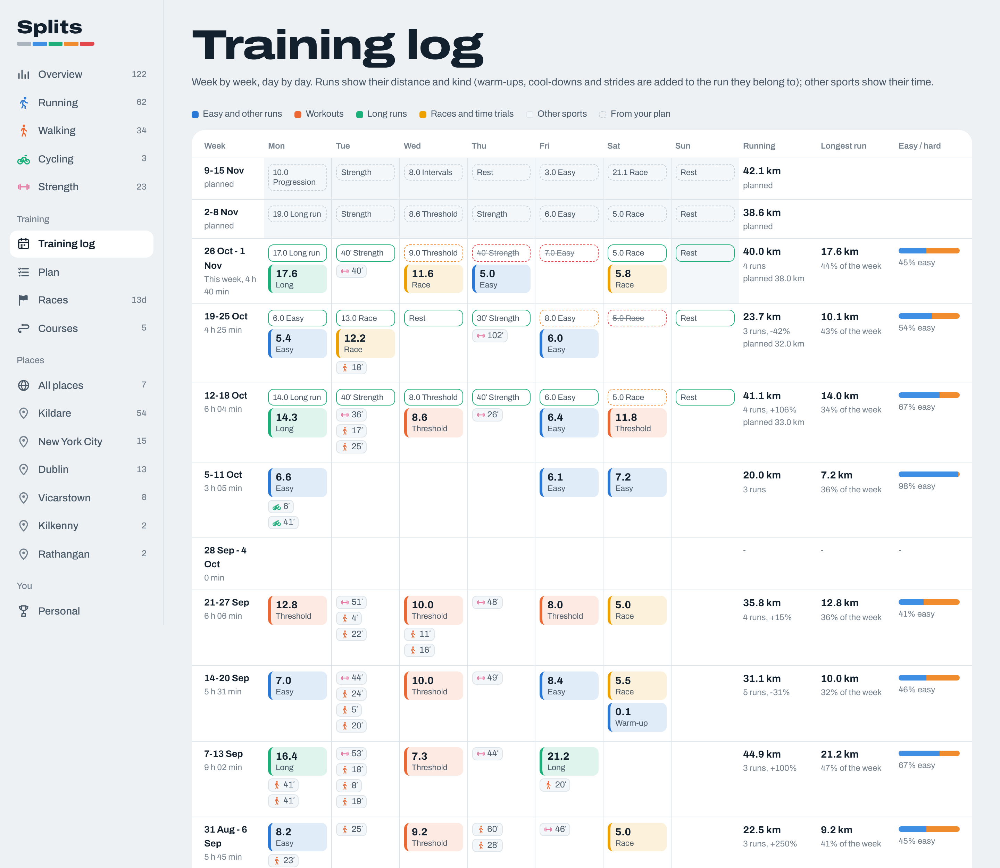
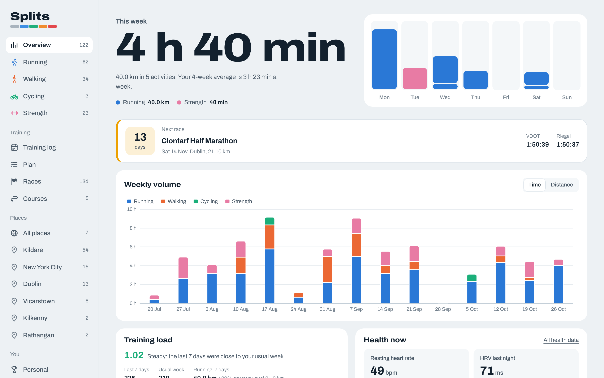
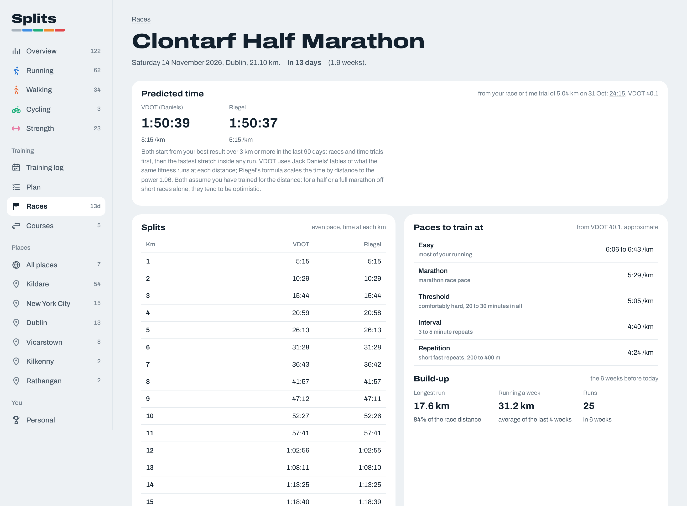
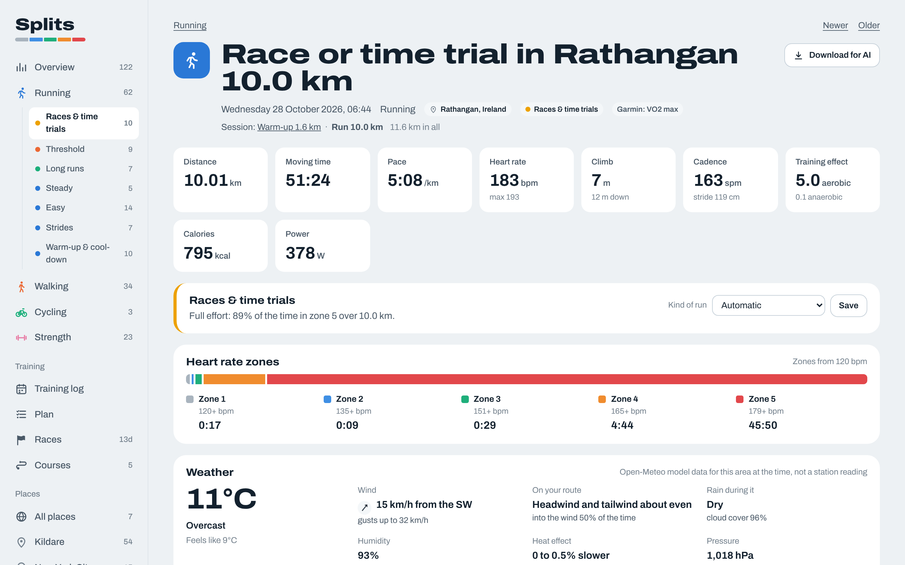
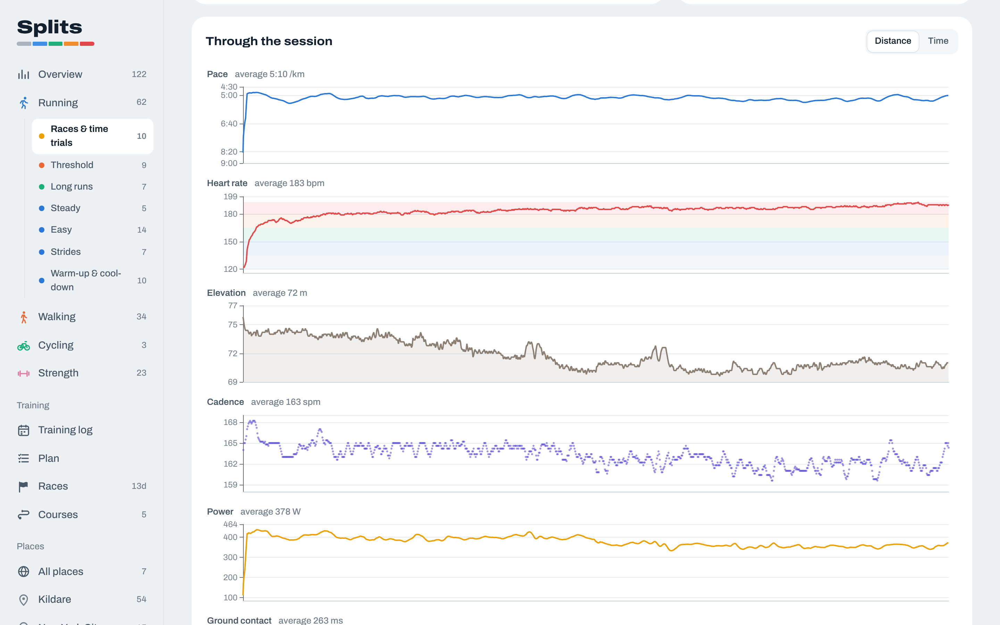
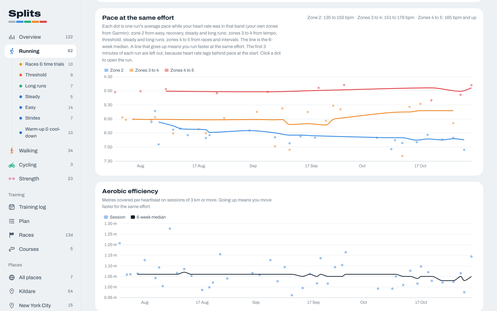
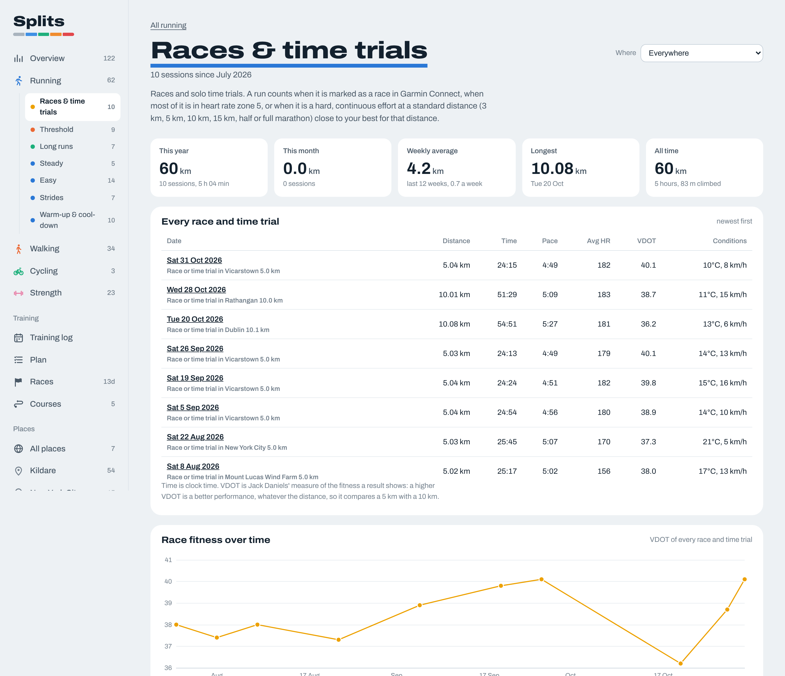
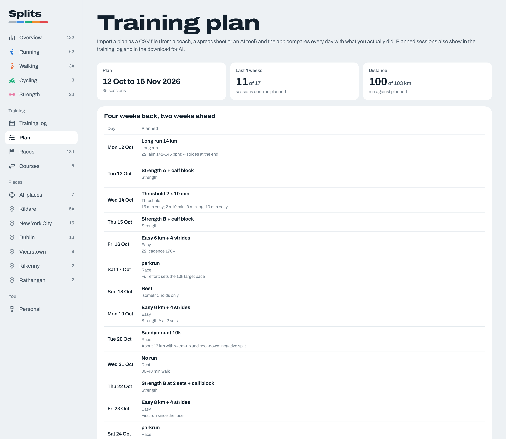
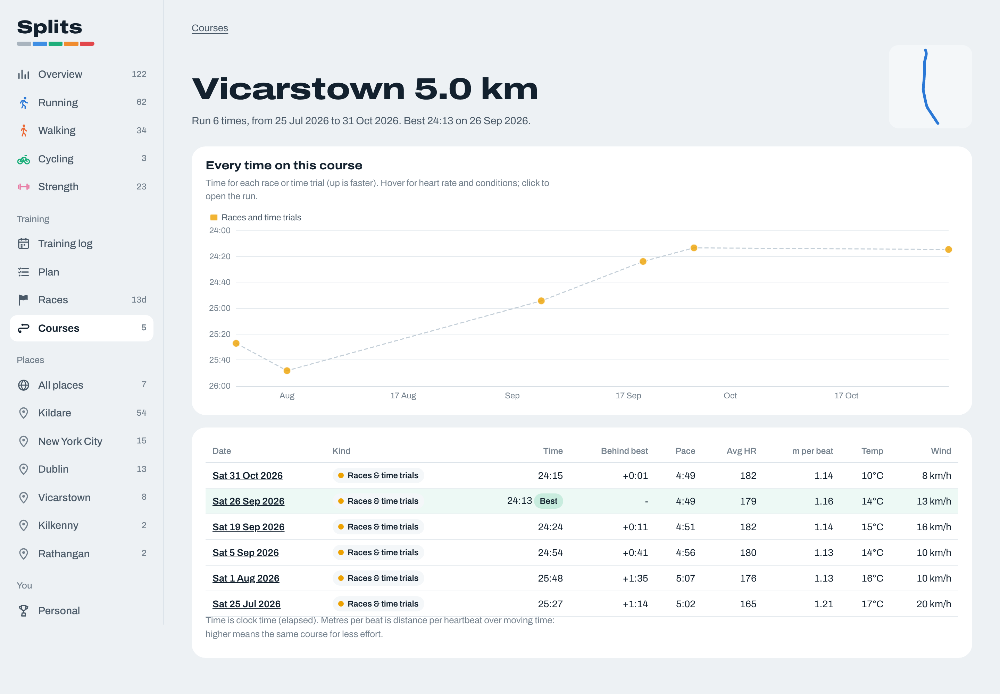
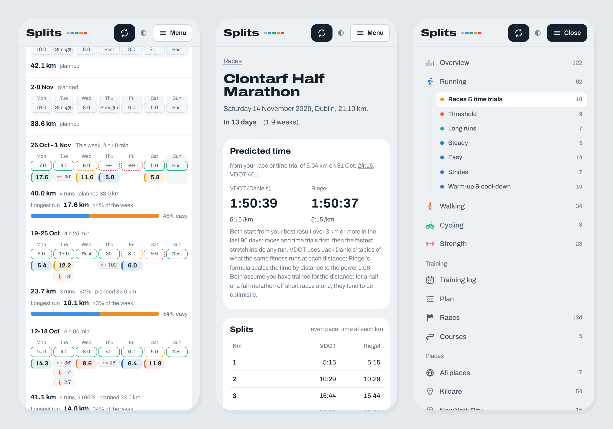

<a id="top"></a>

# Splits

A personal training dashboard built on Garmin's official Personal API. It pulls
every activity and your daily health data into a local database.



## Contents

- [What it shows](#what-it-shows)
  - [Screenshots](#screenshots)
- [Setup](#setup)
  - [Get your Garmin Personal API key](#garmin-key)
  - [Maps: get a CARTO key and URLs (optional)](#carto-key)
- [Use](#use)
  - [Open it on your phone](#phone)
- [Races and predictions](#races)
- [Training plan](#plan)
- [Download a run for AI tools](#download)
- [How runs are sorted](#run-kinds)
- [Places](#places)
- [Weather](#weather)
- [How the Garmin side works](#garmin-side)
- [Project layout](#layout)
  - [Testing without Garmin](#testing)
- [License](#license)
- [Credits](#credits)

<a id="what-it-shows"></a>

## What it shows

It shows:

- **Overview**: this week against your recent weeks, weekly volume by sport,
  training load (the last 7 days against your usual week, with the ratio of the
  two), your next race with its predicted time, activity day by day since your
  first activity, health at a glance, and a feed of every activity grouped by
  week.
- **Training log**: week by week, day by day, every session in its own cell
  with its distance and kind, and per week the running distance and its change,
  the longest run and its share of the week, and the easy / hard split. With a
  training plan imported, every day also shows what was planned and whether it
  was done, and the weeks ahead show the plan.
- **Training plan**: import a plan as a CSV file (from a coach, a spreadsheet or
  an AI tool) and see, day by day, what was planned against what you ran (see
  below).
- **Races**: add the races you have entered. Each gets a predicted time by
  Jack Daniels' VDOT and by Riegel's formula, the pace, km-by-km splits for your
  goal and both predictions, the paces to train at, and your build-up so far.
  After the race, your result against each prediction.
- **Courses**: races and time trials run on the same course more than once,
  found from the GPS track (same start and finish, same distance, mostly the
  same roads). Each course lists every attempt with heart rate and conditions.
- **One page per sport** (running, walking, cycling, ...): month by month and
  day by day volume, pace at the same effort (your pace in zone 2, zones 3 to 4
  and zones 4 to 5, from your own heart rate zones), aerobic efficiency, best
  efforts over every distance month by month, weather against efficiency, when
  you train, distance spread, cadence.
- **Kinds of run**: every run is sorted into races and time trials, threshold,
  intervals, progression, long runs, steady, easy, recovery, strides, and
  warm-up and cool-down. Each kind has its own page under Running with a table
  made for that kind: race time and VDOT for races (and race fitness over time),
  fast blocks and their pace for threshold and interval sessions, fast finish
  and decoupling for long runs, pace in zone 2 and decoupling for easy runs.
  Open a run to see why it was sorted that way, or to change it. A
  warm-up, cool-down or strides run is shown with the run it belongs to (same
  day, at most 40 minutes apart) and counts as one session.
- **Places**: every activity recorded with GPS gets the town or city where it
  started. Each place and each country has a page with a map of every route
  there, and every sport and kind of run page can be filtered to one place
  ("easy runs in Lisbon").
- **Activity detail**: route map coloured by heart rate zone, pace, heart rate,
  elevation, cadence, power, ground contact, vertical oscillation, vertical
  ratio, stride length and headwind through the session, the fast blocks of a
  workout, stretches where heart rate did not follow pace, aerobic decoupling,
  the two halves of an out-and-back or each lap of a circuit, splits with wind,
  laps, time in zones, weather at the time, best efforts inside the session, the
  course it was run on and how it compares with your last 90 days.
- **Personal**: lifetime totals, streaks, personal bests, records per sport,
  month by month and day by day, heart rate zones, fitness age, weight.
- **Download for AI**: every run has a button that downloads one Markdown file
  with everything about it, ready to give to ChatGPT, Claude or any other AI
  tool (see below).
- **Health**: sleep and sleep need, heart rate (resting, asleep, daily range),
  HRV, VO2max, pulse ox, breathing rate, stress and its levels through the day,
  body battery, steps, floors, intensity minutes, calories, weight, each with a
  short note on how to read it, and 30 days to all-time views.

<a id="screenshots"></a>

### Screenshots

All taken with real data from one runner's training for a half marathon.

**Overview**: this week, the next race with its predicted time, weekly volume.



**A race**: the predicted time by VDOT and by Riegel, km-by-km splits, the paces to
train at and the build-up so far.



**An activity**: totals, why it was sorted as a race, heart rate zones, the weather
and headwind, the route coloured by heart rate zone and splits with wind.



**Through the session**: pace, heart rate, elevation, cadence, power and running
dynamics, linked to each other and to the map.



**Pace at the same effort**: pace in zone 2, zones 3 to 4 and zones 4 to 5 over
time, and aerobic efficiency.



**Races and time trials**: every result with its VDOT, and race fitness over time.



**Training plan**: planned against done, day by day.



**A course**: every race run on the same course, matched from the GPS track.



Everything runs on your own computer. The Garmin key, the database and the
downloaded activity files stay in this folder and are excluded from git.


[Back to top](#top)

<a id="setup"></a>

## Setup

Works on macOS, Linux and Windows. You need [uv](https://docs.astral.sh/uv/),
the Python project manager. It installs the right Python and the packages for you.

1. Install uv, if you do not have it yet:

   ```bash
   # macOS and Linux
   curl -LsSf https://astral.sh/uv/install.sh | sh
   # or with Homebrew
   brew install uv
   ```

   ```powershell
   # Windows
   powershell -ExecutionPolicy ByPass -c "irm https://astral.sh/uv/install.ps1 | iex"
   ```

   If none of those work for you, uv is also on PyPI, so any Python 3.8 or newer
   with pip can install it:

   ```bash
   pip install uv          # or: pipx install uv
   ```

2. Get the code:

   ```bash
   git clone https://github.com/idomingo/splits.git
   cd splits
   ```

3. Want to look around first? Start it with made-up data (no Garmin key needed):

   ```bash
   uv run manage.py start --demo
   ```

   The first run creates `.venv`, installs Python 3.10 or newer if needed plus three
   packages (Django, requests, fitdecode), and builds a demo database
   (`data/demo.sqlite3`, three years of a runner who lives in Amsterdam). That
   takes about a minute; then the dashboard opens in your browser.
4. For your own data, get a Garmin Personal API key ([how](#garmin-key)), then run:

   ```bash
   uv run manage.py start
   ```

   The first time, it creates the database and an `.env` file (a copy of
   `.env.example`) and says the key is not set yet. Stop it with Ctrl+C, open
   `.env` in a text editor and paste the key after `GARMIN_PERSONAL_API_KEY=`
   (no quotes, no spaces). `.env` is in `.gitignore`, so it is never committed.
5. Check the key and see which data Garmin returns:

   ```bash
   uv run manage.py garmin_check
   ```

   The output shows status codes and field names only, never the key or your values.

Prefer pip? `requirements.txt` has the same three packages:
`python -m venv .venv`, activate it, `pip install -r requirements.txt`, then use
`python manage.py ...` wherever this README says `uv run manage.py ...`.

<a id="garmin-key"></a>

### Get your Garmin Personal API key

The app only reads from Garmin; the key cannot change anything in your account.

1. Sign in to [Garmin Connect](https://connect.garmin.com) in a browser with the
   account your watch syncs to.
2. Open <https://connect.garmin.com/app/settings/personalApiToken> (Settings,
   then the Personal API token page).
3. Create a new key. If Garmin asks for a name or an expiry, any name works;
   a longer expiry means renewing it less often (keys last 30 days to 1 year).
4. Copy the key straight away: Garmin shows it only once. If you lose it, delete
   it on the same page and create another.
5. Paste it into `.env` as `GARMIN_PERSONAL_API_KEY=...` and run
   `uv run manage.py garmin_check`.

Treat the key like a password: do not paste it into chats, issues or screenshots.
When it expires the sync says the key was rejected; create a new one and replace
the line in `.env`.

<a id="carto-key"></a>

### Maps: get a CARTO key and URLs (optional)

Without anything set, maps use OpenStreetMap's own tiles and work fine. A free
CARTO key gives cleaner basemaps, sharp at every zoom, with a dark style in dark mode.

1. Go to <https://carto.com/basemaps/apikey/>, sign up or sign in, and create a
   basemaps API key (the free tier is enough for personal use).
2. Add it to `.env`:

   ```
   CARTO_API_KEY=your-key
   ```

   That alone is enough: the app uses the Voyager style and its dark-matter
   counterpart, and adds the key to every CARTO request.
3. Optional, to pick another style, set the URLs as well (replace `YOUR_KEY`):

   ```
   CARTO_VECTOR_STYLE_URL=https://basemaps.cartocdn.com/gl/voyager-gl-style/style.json?key=YOUR_KEY
   CARTO_VECTOR_STYLE_URL_DARK=https://basemaps.cartocdn.com/gl/dark-matter-gl-style/style.json?key=YOUR_KEY
   CARTO_RASTER_TILE_URL=https://basemaps.cartocdn.com/rastertiles/voyager/{z}/{x}/{y}.png?key=YOUR_KEY
   ```

   Other CARTO styles are `positron` and `dark-matter` in the same URL pattern
   (for example `.../gl/positron-gl-style/style.json`).
4. Restart the dashboard (Ctrl+C, then `uv run manage.py start`).

The vector style is drawn with MapLibre. The raster URL is the fallback when the
vector style cannot load. The key is sent to the browser with each CARTO
request, which is how CARTO keys work, so restrict it to your own use.

[Back to top](#top)

<a id="use"></a>

## Use

```bash
uv run manage.py start               # opens http://127.0.0.1:8000
uv run manage.py start --port 8080   # another port
uv run manage.py start --no-browser  # do not open the browser
uv run manage.py start --lan         # also open it from your phone (see below)
```

Click **Sync now** (or **Fetch my history** the first time). The first sync reads
your whole history: the activity list first, then one recording per activity,
then sleep, HRV and the daily summaries. Later syncs only fetch what is new.

From the terminal instead:

```bash
uv run manage.py sync_garmin             # what is new
uv run manage.py sync_garmin --full      # re-read everything
uv run manage.py sync_garmin --recheck   # retry data sets marked as not available
```

The demo (`uv run manage.py start --demo`) keeps its data in
`data/demo.sqlite3`, separate from yours. Delete that file to build it again
after an update.

To update: `git pull`, then start as usual. New packages and database changes
are applied by themselves.

<a id="phone"></a>

### Open it on your phone

The dashboard runs on your computer, so a phone can open it when both are on the
same Wi-Fi:

```bash
uv run manage.py start --lan
```



The terminal then prints a second address, like
`http://192.168.1.23:8000/?key=...`. Open that link on your phone once (typing it
or sending it to yourself); the phone keeps the key, so later you can open
`http://192.168.1.23:8000` or add it to your home screen. Everything works from
the phone, Sync included.

- The computer has to be on, awake and running the dashboard.
- Without `--lan` the dashboard only listens on the computer itself, as before.
- With `--lan`, anyone on the same network could reach the address, so every
  device other than the computer needs the key. Requests without it get a page
  asking for the link. Keep the link private, and use `--lan` on networks you
  trust (home, not a café).
- The key is made once and kept in `data/lan_key.txt` (never committed). Delete
  that file and restart to make a new key, which signs every phone out.
- The first time, macOS (or Windows) may ask whether Python can accept incoming
  connections: allow it, or the phone cannot connect.
- The computer's address can change when it reconnects to the Wi-Fi; the
  terminal shows the current one at every start.
- Nothing is reachable from outside your network: this is not a public website.

[Back to top](#top)

<a id="races"></a>

## Races and predictions

Add a race under **Races** with its name, place, date, distance and, if you like,
a goal time. The app works out:

- your current fitness: the best result over 3 km or more in the last 90 days,
  races and time trials first, then the fastest stretch inside any run;
- a predicted time by **VDOT**: Jack Daniels' measure of the fitness a result
  shows, from his and Gilbert's oxygen cost equations, used to find the time the
  same fitness runs at the race distance;
- a predicted time by **Riegel**: the result scaled by distance to the power 1.06;
- the pace for each, and for your goal, with the VDOT your goal needs;
- splits: the time at every kilometre for your goal and both predictions;
- paces to train at (easy, marathon, threshold, interval, repetition), from your
  VDOT, as approximations of Daniels' tables;
- your build-up: longest run and running per week over the last 6 weeks.

Both predictions assume you trained for the distance; from short races alone they
tend to be optimistic for a half or a full marathon. After race day the page shows
your result (the race or time trial run that day at about that distance) against
your goal and each prediction.

[Back to top](#top)

<a id="plan"></a>

## Training plan

Import a plan under **Plan** as a CSV file (or paste it). One row per session:

```
date,kind,title,distance_km,duration_min,pace,description
2026-11-04,threshold,3 x 10 min threshold,10,,5:05,"2 km warm-up; 3 x 10 min, 2 min jog; cool-down"
2026-11-05,rest,Rest,,,,
2026-11-08,long,Long run,18,,6:20-6:40,Last 3 km at half marathon pace
```

- `date` (YYYY-MM-DD) and `kind` are needed; the rest is optional.
- `kind`: easy, long, threshold, intervals, progression, steady, recovery, race,
  strides, rest, strength, cross (tempo is read as threshold).
- `distance_km` is the whole session, warm-up and cool-down included;
  `duration_min` is for sessions planned by time; `pace` is free text.
- Commas, semicolons or tabs between columns all work; a description with commas
  goes in double quotes.
- Importing replaces the sessions between the first and last date in the file
  (or the whole plan, if you choose), so a revised plan can be imported again.

The Plan page has a template to download and a ready-made prompt to copy: paste it
into ChatGPT, Claude or another AI tool after your request ("a 6-week plan for a
half marathon on 6 December, 4 runs a week") and it answers in this format.

A planned run counts as done when you ran that day within 20% of the planned
distance. The plan shows on the Plan page (four weeks back, two ahead), in the
training log, and in the download for AI (the plan for that day and the week
around it).

[Back to top](#top)

<a id="download"></a>

## Download a run for AI tools

The **Download for AI** button on each run (on its page and on every run card)
saves a file named like `2026-10-25 08h29 Long run in Haarlem 19.8 km.md`. It
has, in this order:

- a short header and a one-paragraph description: what kind of run, where, when;
- totals, running dynamics, Garmin's training effect and VO2max estimate;
- time in heart rate zones, and why the run was sorted as that kind;
- stretches where heart rate did not follow pace (for example a strap or an
  optical sensor taking a few minutes to lock on), marked without judging which
  reading is right; zone times, splits and laps then come with and without them;
- aerobic decoupling (pace and power against heart rate, first half against
  second half) for easy, recovery, steady and long runs;
- the weather at the time and hour by hour, with headwind along the route;
  the heat effect uses the temperature + dew point rule of thumb in °C;
- splits per km worked out from the recording (pace, heart rate, cadence, power,
  climb, ground contact, headwind), the watch's own laps and the best efforts;
- when the GPS track clearly shows it, the two halves of an out-and-back route
  or each lap of a circuit, with pace, heart rate and headwind for each;
- for a race or time trial, the earlier ones on the same course (or else in the
  same place), with time, heart rate and conditions;
- the training plan for that day and the week around it, and the races ahead,
  when you have added them;
- training context: the four weeks before, every run in the 14 days before,
  personal bests, and sleep, HRV, resting heart rate and body battery that day;
- every summary field Garmin sends for the activity;
- every point the watch recorded (usually one per second), as CSV.

The descriptive parts are Markdown and the long tables are CSV, which costs AI
tools fewer tokens than the same numbers as Markdown tables. GPS coordinates are
left out on purpose, since a start point is often a front door. A long run
recorded every second is a few hundred KB; tools that can run code (ChatGPT's
data analysis, Claude's analysis tool) handle the per-second part best.


[Back to top](#top)

<a id="run-kinds"></a>

## How runs are sorted

Nothing is tuned to one person. Every rule uses either the run itself (its heart
rate zones from your Garmin settings, its pace trace) or your own history (your
easy pace and usual run length over the weeks before, your best efforts):

1. Runs under 35 minutes within 40 minutes of a longer run the same day are
   warm-ups or cool-downs; short fast ones straight after a run are strides.
2. Races and time trials: marked as a race in Garmin Connect, mostly in zone 5,
   or a hard continuous effort at 3 km, 5 km, 10 km, 15 km, half or full
   marathon distance close to your best for it.
3. Workouts from the pace trace: blocks at least 18% faster than your easy pace.
   Two or more blocks averaging 3 minutes or more are threshold, shorter ones
   intervals; a steady build is a progression.
4. Long runs: 90 minutes or more, or an hour and one and a half times your usual
   run. Then steady (zones 3 to 5), recovery (short and easy) and easy.

A kind you pick on the activity page always wins.


[Back to top](#top)

<a id="places"></a>

## Places

Places are worked out on your computer from the start point of each activity,
using the GeoNames list of towns with 1,000 people or more (bundled in
`dashboard/geodata`). A city counts for its whole area, so a run in a suburb
counts for the city; anywhere outside a city's area gets the nearest town.
Indoor sessions and anything without GPS have no place. Rename a place on its
page if you prefer another name. To refresh the bundled lists from GeoNames, run
`uv run --with geonamescache devtools/build_geodata.py`.


[Back to top](#top)

<a id="weather"></a>

## Weather

Outdoor runs, walks and rides get the weather at their start point and time from
[Open-Meteo](https://open-meteo.com): no key, free for personal use. The sync
asks once per activity (temperature, feels like, humidity, dew point, rain, wind
and gusts, cloud, pressure, visibility) and stores it, so each activity is only
fetched once. From that the app works out the headwind or tailwind at every point
of the route and per split. These are model values for the area, not a weather
station on your street. To fetch it again for everything:

```bash
uv run manage.py fetch_weather --all
```


[Back to top](#top)

<a id="garmin-side"></a>

## How the Garmin side works

- The key is exchanged for an access token (24 hours, no refresh). The token is
  cached in `data/token.json` and renewed after 20 hours.
- Responses over about 256 KB fail on Garmin's side, so the app pages activities
  20 at a time and asks for health data in 28-day windows. When Garmin still
  says a window is too large, the app splits it in half and tries again.
- 429 and 5xx answers are retried with a pause. A 404 means the endpoint is not
  part of the Personal API; the app notes that and skips it on later syncs.
- Activity recordings come as FIT files (inside a ZIP). They are kept in
  `data/fit/` and turned into down-sampled series, per-km splits and best efforts.
- Every Garmin record keeps its raw JSON. If Garmin renames a field, fix the
  mapping in `dashboard/garmin/extract.py` and run
  `uv run manage.py rebuild_from_raw`: no new calls to Garmin needed.
- Keys expire (30 days to 1 year). When the sync says the key was rejected,
  create a new one and replace it in `.env`.


[Back to top](#top)

<a id="layout"></a>

## Project layout

```
config/                  Django settings and URLs
dashboard/
  garmin/client.py       token, retries, range splitting
  garmin/sync.py         the sync phases (activities, files, health data)
  garmin/extract.py      Garmin JSON -> model fields
  fitparse.py            FIT/ZIP reader
  streams.py             splits, best efforts, route outline, zones
  analytics.py           numbers behind each page
  views.py, templates/   pages
  static/dashboard/      CSS, JS, ECharts, Leaflet, Archivo font
  runtypes.py            how each run is sorted into a kind
  places.py              offline town and city lookup, place filters
  courses.py             race courses run more than once, found from the GPS track
  racing.py              VDOT and Riegel predictions, splits, training paces
  plan.py                training plan import (CSV) and planned against done
  lan.py                 opening the dashboard from a phone on the same Wi-Fi
  export.py              one run as a Markdown file for AI tools
  geodata/               GeoNames towns and countries (CC BY 4.0)
  weather.py             Open-Meteo client, headwind along the route
  derive.py              fills in kinds and places missing after an update
  management/commands/   sync_garmin, garmin_check, seed_demo, rebuild_from_raw,
                         fetch_weather, assign_places
devtools/mock_garmin.py  a fake Garmin API for testing without a key
devtools/build_geodata.py  rebuilds dashboard/geodata from GeoNames
```

<a id="testing"></a>

### Testing without Garmin

```bash
uv run --group dev devtools/mock_garmin.py --port 8765 &
GARMIN_API_BASE=http://127.0.0.1:8765 GARMIN_PERSONAL_API_KEY=test-key \
  DB_PATH=data/mock.sqlite3 uv run manage.py sync_garmin
```

The mock also answers Open-Meteo requests: add
`WEATHER_FORECAST_URL=http://127.0.0.1:8765/v1/forecast WEATHER_ARCHIVE_URL=http://127.0.0.1:8765/v1/archive`.


[Back to top](#top)

<a id="license"></a>

## License

MIT, see [LICENSE](LICENSE). What changed in each version is in [CHANGELOG.md](CHANGELOG.md). Bundled third-party parts keep their own licenses (listed below).


[Back to top](#top)

<a id="credits"></a>

## Credits

Weather data by [Open-Meteo](https://open-meteo.com) (CC BY 4.0).

Place names from [GeoNames](https://www.geonames.org) (CC BY 4.0), via the
[geonamescache](https://github.com/yaph/geonamescache) package (MIT).

Charts: [Apache ECharts](https://echarts.apache.org) (Apache 2.0). Maps:
[MapLibre GL JS](https://maplibre.org) (BSD 3) and [Leaflet](https://leafletjs.com) (BSD 2),
map data by OpenStreetMap contributors, basemaps by CARTO.

Font: [Archivo](https://github.com/Omnibus-Type/Archivo) (SIL Open Font License).

Not affiliated with Garmin.

[Back to top](#top)
